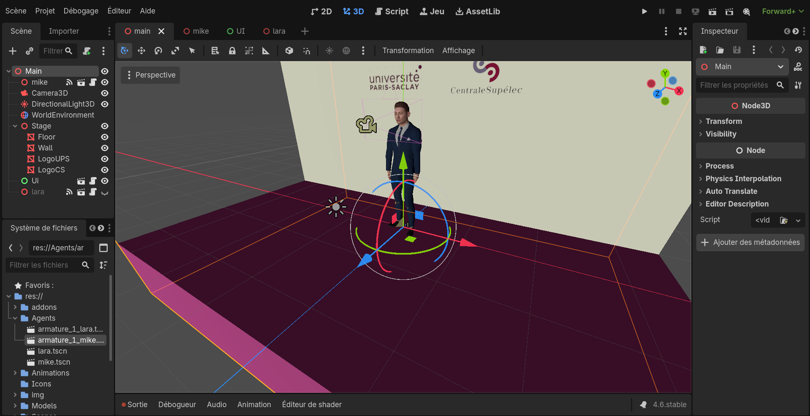
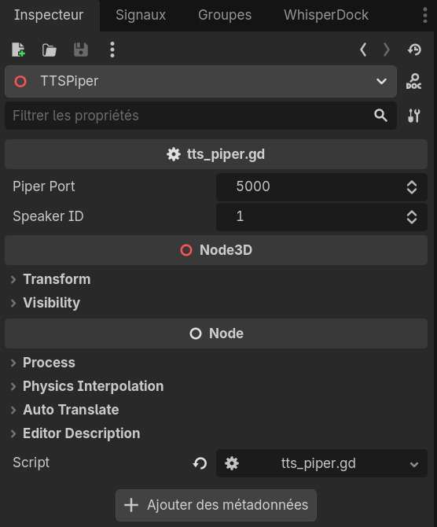
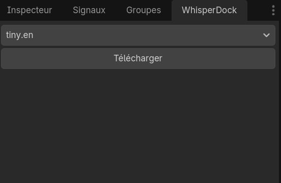

# Mike the Pedagogical Agent

Welcome to the official repository of **Mike The Pedagogical Agent** v3.0 now powered by Godot.

This project started as a Unity3D project, originally created for a CentraleSupelec Lecture on Artificial Intelligence and Social Sciences.

This project contains the foundation of a Socially Interactive Agent or Embodied Conversational Agent.
It is greatly inspired by other projects such as Greta, Marc and the Virtual Human Toolkit.
It was not really designed to fully reproduce the capacity of a SIA, but to offer an easy way for students to discover how an agent can work.

For now, the developped functionalities allows the agent to :

- Run a dialog using an external LLM (start and stop recording your voice with the SpaceBar, the agent will then reply).  
- Follow an object with its gaze (by default, the camera)
- Perform some pre-rendered animations (downloaded from Mixamo)
- Do basic lip animation mixed with facial expressions while there is audio playing

The project is quite light and straightforward. It does not compete with other exising agent plaforms such as [Greta](https://github.com/isir/greta), Marc or [VHTK](https://vhtoolkit.ict.usc.edu/) but can be a good playground to manipulate an interactive character.

Actual version uses Avaturn 3D Models.

# Installation

You can clone the current project using your favorite Git Client or you can download it as a zip archive and extract it on your drive.

Mike the PA should work on Linux, Windows and MacOS versions of Godot starting from version 4.6.

For the TextToSpeech, it uses [Piper-TTS](https://github.com/OHF-Voice/piper1-gpl). You can follow their instructions to install Piper-TTS, to download voices and to serve them locally.

For the SpeechToText, it uses [Godot Whisper](https://github.com/V-Sekai/godot-whisper). The default tiny.en model for english is provided but downloading additional (and bigger) language models can be done from [huggingfaces](https://huggingface.co/collections/openai/whisper-release)
 (or [here](https://huggingface.co/ggerganov/whisper.cpp/tree/main))
As a Godot project, you need to add the project in your project's list using Godot "Import" functionality.

# Overview of the project architecture

Once the project opened in Godot, open the *main.tscn* file to load the default *scene*. If you are familiar with Godot, you should get around quite easily.

> [!IMPORTANT]  
> In Godot, every game object (including the scene) is organized as a tree of nodes refered to as a *scene*. A Godot *scene* is usually stored within a *.tscn* file that stores this tree. The important thing to understand is that a level is a *scene* and even small game objects are *scenes*.

The main scene tree is composed of various nodes for rendering the main scene (a camera, some lighting, backgrounds...) and most importantly, a node for our agent, the **mike** node (by default, we are using the **mike** male agent but there is also a **lara** female agent).

In this tree, you can see that some nodes are equipped with a script (the **mike** node and the **UI** node for instance). Scripts are written in GDScript and are stored in *.gd* file. A node can receive only one script at max and once a script is attached to a Node, the Godot Engine will automatically call its **_ready** (once at startup) and **_process** (once every frame) functions.

> [!NOTE]  
> To get familiar with how Godot works, I suggest to explore its [documentation](https://docs.godotengine.org/en/stable/).

The **mike** node is imported from another *.tscn* file (*mike.tscn*) describing its tree of nodes. You can open this file to see (and modify) its scene. Modifying the *mike.tscn* file will automatically propagate the changes to the *main.tscn* scene since this one imports the **mike** node from this file.

When you click on a node in the tree view on the left of the interface, the inspector on the right automtically display the various properties that are editable on this particular Node. This list of properties depends on the type of Node and on the attached script.

For instance, in the *mike.tscn* scene, clicking on the TTSPiper node lets you change in the inspector the port number.

## Piper-TTS

By default, the agent expects that Piper-TTS is running on your machine and serving a voice model at **http://localhost:5000**. 

> [!NOTE]  
> To install Piper-TTS, download voices and serve them locally, please have a look at their documentation : [Piper-TTS](https://github.com/OHF-Voice/piper1-gpl)

## Whisper

Whisper is the tool used for realizing Speech To Text. It uses the C++ Wrapper from the Godot extension called [Godot Whisper](https://github.com/V-Sekai/godot-whisper).
Clicking on the Whisper node allows you to change in the inspector the language that should be detected and which Whisper model it uses.

By default, we provide the tiny.en model which is small enough to be fast but is limited to english. The *WhisperDock* tab on the top-right of the interface allows you to download bigger models which are multilingual but slower.

## LLMExchange

This is the Node in charge of sending request to the LLM. If you click on the node, you will be able to change various parameters in the inspector.

# Usage

For now, the project is supposed to be executed from the Godot Editor (you can always build and export the build if it is more convenient for you).
You can start the project by clicking on the play button from the Godot Interface. Once the agent is running, you only have to press Space Bar to start recording your voice and press again to stop recording. The agent will process the audio, send the transcription to the LLM, get the response and say it.

## Credits

- TextToSpeech from [Piper-TTS](https://github.com/OHF-Voice/piper1-gpl)
- SpeechToText from [Godot Whisper](https://github.com/V-Sekai/godot-whisper)
- Emotion recognition from [Omar Ayman](https://github.com/otaha178/Emotion-recognition)

If you use **Mike the Pedagogical Agent** in one of your projects, citing this repository is appreciated.

Copyright. Brian Ravenet
