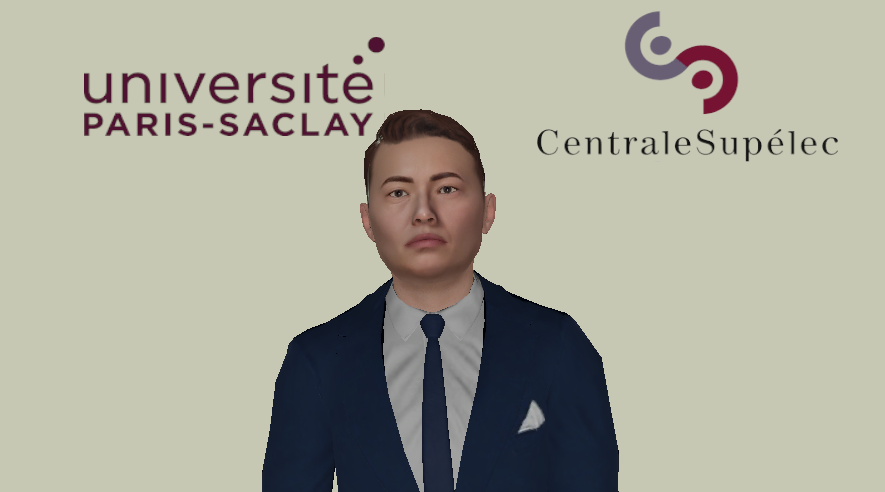
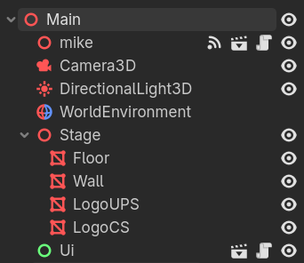
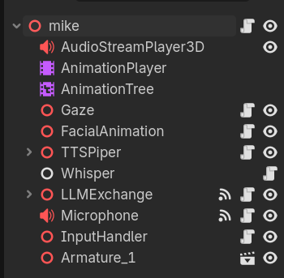
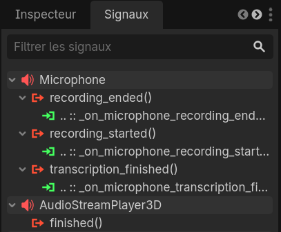
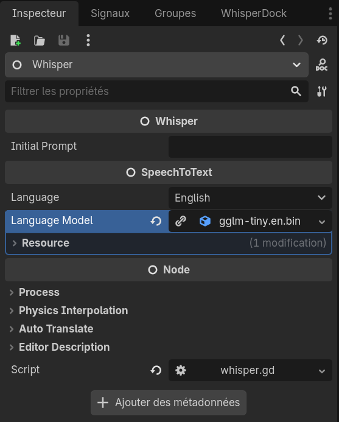
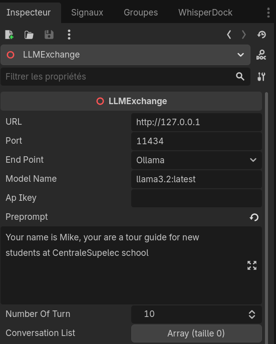

# Mike the Pedagogical Agent

Welcome to the official repository of **Mike The Pedagogical Agent** v3.0 now powered by Godot.

{width=75%}

This project started as a Unity3D project, originally created for a CentraleSupelec Lecture on Artificial Intelligence and Social Sciences.

This project contains the foundation of a Socially Interactive Agent or Embodied Conversational Agent.
It is greatly inspired by other projects such as Greta, Marc and the Virtual Human Toolkit.
It was not really designed to fully reproduce the capacity of a SIA, but to offer an easy way for students to discover how an agent can work.

For now, the developped functionalities allows the agent to :

- Run a dialog using an external LLM (start and stop recording your voice with the SpaceBar, the agent will then reply).  
- Follow an object with its gaze (by default, the camera)
- Perform some pre-rendered animations (downloaded from Mixamo)
- Do basic lip animation mixed with facial expressions while there is audio playing

The project is quite light and straightforward. It does not compete with other exising agent plaforms such as [Greta](https://github.com/isir/greta), Marc or [VHTK](https://vhtoolkit.ict.usc.edu/) but can be a good playground to manipulate an interactive character.

Actual version uses Avaturn 3D Models.

# Installation

You can clone the current project using your favorite Git Client or you can download it as a zip archive and extract it on your drive.

Mike the PA should work on Linux, Windows and MacOS versions of Godot starting from version 4.6.

For the TextToSpeech, it uses [Piper-TTS](https://github.com/OHF-Voice/piper1-gpl). You can follow their instructions to install Piper-TTS, to download voices and to serve them locally. Mike The PA expects Piper-TTS version 1.8.0 running with Python 3.14.10 (this recent version uses an endpoint like **http://localhost:5000/synthesize**).
 

> [!NOTE]
> The project can also use the Godot integrated TTS. This solution wraps the Operating System TTS on which Godot is running. Therefore, depending on your Operating System, you might have various results since available voices will depend on your setup.

For the SpeechToText, it uses [Godot Whisper](https://github.com/V-Sekai/godot-whisper). The default tiny.en model for english is provided but downloading additional (and bigger) language models can be done from [huggingfaces](https://huggingface.co/collections/openai/whisper-release), from [here](https://huggingface.co/ggerganov/whisper.cpp/tree/main) or from the WhisperDock tab in the Godot Editor.

As a Godot project, you need to add the project in your project's list using Godot "Import" functionality.

# Quick start (macOS, OpenRouter free model)

This is the setup used on this machine: Piper TTS served locally, the LLM served by [OpenRouter](https://openrouter.ai) with free models, Godot 4.6+.

## 1. Prerequisites

- Godot 4.6 or newer (tested with the version in `~/Downloads/Godot.app`).
- Python 3.12+ (3.14 works) with `piper-tts` and `flask`:

```bash
python3 -m venv .venv
source .venv/bin/activate
pip install piper-tts flask
python3 -m piper.download_voices en_GB-alan-low
```

- An OpenRouter account and an API key (openrouter.ai → *Keys*).

## 2. Save the OpenRouter key outside the project

The key is read from the `OPENROUTER_API_KEY` environment variable, then from a file in Godot's user folder. On macOS, Godot launched from the Dock does not see shell variables, so use the file:

```bash
KEYDIR=~/Library/Application\ Support/Godot/app_userdata/MikeTPAGodot
mkdir -p "$KEYDIR"
echo 'sk-or-YOUR-KEY' > "$KEYDIR/openrouter_key.txt"
chmod 600 "$KEYDIR/openrouter_key.txt"
```

> [!WARNING]
> Never type the key in the Godot Inspector (`APIkey`): it would be saved in the `.tscn` file and committed.

## 3. Start everything

```bash
./start_mike.sh
```

The script checks the key and the connection, starts Piper on **port 5001** and opens the project in Godot. Then press **Play** in Godot, **Space** to start recording, **Space** again to stop. `Ctrl+C` in the terminal stops Piper.

Options: `MIKE_VOICE=en_US-bryce-medium ./start_mike.sh` (other voice), `GODOT_APP=/path/Godot.app ./start_mike.sh` (Godot elsewhere).

## 4. Where to change things

| What | Where |
|---|---|
| System prompt (agent context) | `LLMExchange` node of `Agents/mike.tscn`, field *Preprompt* |
| LLM endpoint (Ollama, OpenWebUI, OpenRouter) | `LLMExchange` → *End Point* |
| LLM model and fallbacks | `LLMExchange` → *Model Name*, *Fallback Models* (OpenRouter accepts at most 3 models in total) |
| Speech recognition language | `Whisper` node → *Language* (currently English) |
| Voice and port | `TTSPiper` node → *Piper Port* (5001), and the voice passed to `piper.http_server` |

## 5. Troubleshooting

| Console message | Cause | Fix |
|---|---|---|
| `429 ... rate-limited upstream` | The free model is saturated for all users | Retry, or change/reorder the fallback models |
| `401` | Wrong or revoked key | Create a new key |
| `no API key found` | Key file missing or empty | Redo step 2 |
| `TTS HTTP error` | Piper is not running | Run `./start_mike.sh` |
| Silent agent, no error | Empty LLM answer or empty transcription | Check the `Received:` line in the Godot console |
| Slow or "deep" voice | Sample rate mismatch | `wav.mix_rate` in `Scripts/tts_piper.gd` is 16000: use 22050 for `medium` voices |

> [!NOTE]
> Port 5000 is used by *AirPlay Receiver* on macOS, which is why Piper runs on 5001 here. Free OpenRouter models change often and can disappear: check [openrouter.ai/models](https://openrouter.ai/models) with the *Free* filter.

> [!NOTE]
> Prompts and transcriptions are sent to OpenRouter and to the model provider. Free models may use them for training depending on your account privacy settings.

# Usage

For now, the project is supposed to be executed from the Godot Editor (you can always build and export it if it is more convenient for you).

You can start the project by clicking on the play button from the Godot Interface. Once the agent is running, you only have to press Space Bar to start recording your voice and press again to stop recording. The agent will process the audio, send the transcription to the LLM, get the response and say it.

By default, the project expects that a Piper-TTS server is running and serving a voice at **http://localhost:5000/synthesize** and that a Ollama LLM server is running and serving a model at **http://localhost:11434**. It is also possible to use an OpenWebUI endpoint by changing a few parameters of the agent components. 


# Overview of the project architecture

Once the project opened in Godot, open the *main.tscn* file to open the default *scene*. If you are familiar with Godot, you should get around quite easily.

{width=75%}

## Nodes

> [!IMPORTANT]  
> In Godot, every game object (including the scene) is organized as a tree of nodes refered to as a *scene*. A Godot *scene* is usually stored within a *.tscn* file that stores this tree. The important thing to understand therefore is that a level is a *scene* and even small game objects are *scenes* in the end. All nodes within the tree inherits from the mother class **Node** but can be from different types.

The main scene tree is composed of various nodes for rendering the main scene (a camera node, some lighting nodes, backgrounds...) and most importantly, a node for our agent, the **mike** node (by default, we are using the **mike** male agent but there is also a **lara** female agent).

{width=25%}

The **mike** node is imported from another *.tscn* file (*mike.tscn*) describing its tree of nodes. You can open this file to see (and modify) its scene. Modifying the *mike.tscn* file will automatically propagate the changes to the *main.tscn* scene since this one imports the **mike** node from this file.

{width=25%}

When you click on a node in the tree view on the left of the interface, the inspector on the right automatically display the various properties that are editable on this particular node. This list of properties depends on the type of the node and on its attached script.

For instance, in the *mike.tscn* scene, clicking on the TTSPiper node lets you change in the inspector the port number and the speaker voice ID (you can also tick the box to use the OS TTS instead of Piper-TTS).

{width=50%}

> [!IMPORTANT]The workflow is like this:
>
> - The **InputHandler** Node of the **mike** node is equipped with a script waiting for input events.
> - When the *Space Bar* is (pressed and) released, the **InputHandler** calls on the **Microphone** Node script a method that will start the recording of the user voice (this method also sends a signal to update the UI).
> - When the *Space Bar* is (pressed and) released again, the **InputHandler** calls on the **Microphone** the same method that will stop the recording this time and calls a method on the **Whisper** Node to transcribe the audio (it also sends a signal to update the UI again).
> - Once the **Whisper** Node finishes the transcription, it sends a signal with the transcription that will be received by the **LLMExchange** Node.
> - Upon reception of this signal, the **LLMExchange** Node updates the conversation list and uses a web request to send it to the LLM instance (by default, an Ollama running at http://localhost:11434)
> - The **LLMExchange** Node receives the response from the LLM, updates the conversation list and sends a signal with the response that will be received by the **TTSPiper** Node
> - Upon reception of this signal, the **TTSPiper** Node sends a web request to the Piper-TTS instance (running by default at http://localhost:5000/synthesize)
> - The **TTSPiper** Node receives the response with the AudioData and makes the **AudioStreamPlayer3D** plays this audio.
> - The **FaceAnimation** is constantly observing if there is audio playing from the agent. When the audio is playing, this Node performs lip animation on the agent viseme blenshapes.

<details>
<summary>

## Scripts

</summary>

In the tree, you can see thanks to the small document icon that some nodes are equipped with a script (the **mike** node and the **UI** node for instance). Scripts are written in GDScript and are stored in *.gd* files. A node can receive only one script at a time and once a script is attached to a Node (itself attached to the scene tree), the Godot Engine will automatically call its **_ready** (once at startup) and **_process** (once every frame) functions.

> [!NOTE]  
> To get familiar with how Godot works, I suggest to explore its [documentation](https://docs.godotengine.org/en/stable/).

</details>
<details>
<summary>

## Signals

</summary>

> [!IMPORTANT]
> In **Mike The Pedagogical Agent**, communication between the components happens mainly thanks to the **signal** mechanism of Godot. A signal is an event emitted by a node. 

For instance, once the microphone Node finishes recording (because the user pressed the Space Bar), it emits a signal. You should find in the GDscript code of the Node this line :

```python
emit_signal("recording_ended")
```

Then, it creates a thread to handle the transcription using the Whisper node and once this transcription is done, it emits another signal containing the transcribed text. 

```python
emit_signal("transcription_finished",transcription)
``` 

Instead of the Inspector on the right, you can click on the Signal tab to diplay which signals of a Node are connected to another. A connection is made by defining what function on a Node will be called when a signal from another Node is emitted. You should see for instance that when the microphone *transcription_finished* signal is emitted, a function from the LLMExchange Node is called. This function will send the received transcription to the LLM...


{width=50%}

I strongly recommend to open and explore the *.gd* script files attached to these nodes to understand this chain of communication (if you want to understand what is happening under the hood).

</details>
<details>
<summary>

## Piper-TTS

</summary>

By default, the agent expects that Piper-TTS is running on your machine and serving a voice model at **http://localhost:5000/synthesize**. 

> [!NOTE]  
> To install Piper-TTS, download voices and serve them locally, please have a look at their documentation : [Piper-TTS](https://github.com/OHF-Voice/piper1-gpl).
> Piper-TTS requires Python and it is recommended to create a virtual environment to install and execute Piper-TTS.
> If you are not familiar with Python virtual environment, I recommend to have a look at [this page](https://docs.python.org/3/library/venv.html).

Below is an example of the commands you should execute to have Piper-TTS serve locally a french voice.

```bash
# 1) here, I am installing python-virtualenv for creating virtual environment and I create one :
sudo apt install python-virtualenv
python -m venv /path/to/new/virtual/environment
# 2) Now I need to activate it  :
source /path/to/new/virtual/environment/bin/activate
# 3) I install piper-tts and flask within the virtual environment :

pip install piper-tts
pip install flask

# 4) I am downloading a french voice (check Piper-TTS website for the list of available voices) :
python -m piper.download_voices fr_FR-gilles-low

# 5) I start the Piper-TTS server to serve the voice with :
python -m piper.http_server -m fr_FR-gilles-low
```

</details>
<details>
<summary>

## Whisper

</summary>

Whisper is the tool used for realizing Speech To Text. It uses the C++ Wrapper from the Godot extension called [Godot Whisper](https://github.com/V-Sekai/godot-whisper).
Clicking on the Whisper node allows you to change in the inspector the language that should be detected and which Whisper model it uses.

{width=50%}

By default, we provide the tiny.en model which is small enough to be fast but is limited to english. The *WhisperDock* tab on the top-right of the interface allows you to download bigger models which are multilingual but slower.

{width=50%}

</details>
<details>
<summary>

## LLMExchange

</summary>

This is the Node in charge of sending request to the LLM. If you click on the node, you will be able to change various parameters in the inspector. By default, the system is configured to send web requests at an Ollama endpoint located at **http://localhost:11434** but this can be modified. Obviously, it is up to you to ensure you have an LLM instance running there (using Ollama or something else).

{width=50%}

> [!NOTE]  
> By default, this script keeps the conversational turns (user and agent) in a list of 10 elements. This means that each time a request is made to the LLM, a maximum of 9 previous turns are sent as well. This allows the agent to maintain a very short term memory of the conversation.

</details>

# Credits

- TextToSpeech from [Piper-TTS](https://github.com/OHF-Voice/piper1-gpl)
- SpeechToText from [Godot Whisper](https://github.com/V-Sekai/godot-whisper)
- Emotion recognition from [Omar Ayman](https://github.com/otaha178/Emotion-recognition)

If you use **Mike the Pedagogical Agent** in one of your projects, citing this repository is appreciated.

Copyright. Brian Ravenet
